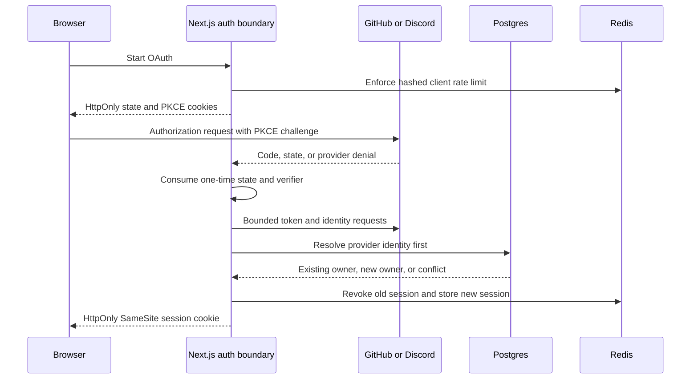

# Next.js OAuth 2.0 Security Reference

[](https://github.com/hskl18/nextjs-oauth-security-reference/actions/workflows/ci.yml)

GitHub and Discord sign-in plus email-link passwords for Next.js, built so that a matching email never counts as proof of account ownership and only the mailbox holder ever chooses a password.

**Status: reference implementation, v0.2.0.** It is not a drop-in identity provider and has no production deployment.
Production builds disable password sign-up and reset until an email provider is wired in.

## Headline result

CI runs 77 tests in 22 files on every push and pull request.
19 of them, in 5 integration files, run only against real PostgreSQL 17 and Redis 7, so database constraints, row locks, and Redis scripts are exercised rather than mocked.

| Attack or race | What the test shows | Test file |
| --- | --- | --- |
| Two concurrent OAuth callbacks for one new provider account | Both resolve to one user and one provider link | `postgresAccountStore.integration.test.ts` |
| OAuth email that matches an existing local account | Sign-in is refused and no provider identity is attached | `postgresAccountStore.integration.test.ts` |
| Two concurrent uses of one password setup link | Exactly one succeeds | `passwordSetup.integration.test.ts` |
| Three concurrent link requests for one user | Exactly one link stays live | `passwordSetup.integration.test.ts` |
| Admin role removed while signed in on two devices | The other device is a plain user on its next request | `sessionRevocation.integration.test.ts` |
| Login that read the session version before a concurrent sign-out-everywhere | Its session is rejected | `sessionRevocation.integration.test.ts` |
| Sixth sign-up attempt within an hour | Rejected, and Redis keys never contain the raw email | `rateLimit.integration.test.ts` |
| Redis that never answers or refuses connections | The rate limit rejects the attempt | `rateLimit.test.ts` |

[DESIGN.md](DESIGN.md) explains the decisions behind these rules and nine failures that were found and fixed, including a rate limiter that failed open and a deadlock reproduced in PostgreSQL.

## Run it

Requires Docker and Node.js 22.13 or newer within the 22.x line, Node.js 24, or Node.js 26 and newer.

```bash
cp .env.example .env.local && docker compose --env-file .env.local up -d && npm ci && npm run db:migrate && npm run dev
```

Open `http://localhost:3000`.
Docker Compose runs PostgreSQL, Redis, and [serverless-redis-http](https://github.com/hiett/serverless-redis-http), an Upstash-compatible REST proxy, so the app uses the same `@upstash/redis` client locally as against Upstash.
In development, password setup links are printed to the server console instead of being emailed.
GitHub and Discord sign-in need your own OAuth apps: replace the `replace-me` values in `.env.local` and register these callback URLs.

```text
http://localhost:3000/api/oauth/github
http://localhost:3000/api/oauth/discord
```

To run the full suite, including the integration tests, against a separate database (they delete every user):

```bash
docker compose --env-file .env.local exec db createdb -U postgres oauth_template_test
set -a; source .env.local; set +a
export DB_NAME=oauth_template_test RUN_DB_INTEGRATION=1 RUN_REDIS_INTEGRATION=1
npm run db:migrate
npm test
```

Without `RUN_DB_INTEGRATION` and `RUN_REDIS_INTEGRATION`, `npm test` runs the 58 tests that need neither service.

## Non-goals

- Replacing Auth.js, Better Auth, an enterprise identity provider, or a managed OAuth broker
- Supporting arbitrary OAuth providers through runtime configuration
- Merging social accounts based only on email
- Claiming compliance, production readiness, or complete resistance to account takeover

## What this implements

- OAuth identity is resolved by `(provider, providerAccountId)` first; an email that matches an existing local account never signs in to or links that account.
- GitHub requires a verified primary email from `/user/emails`, and Discord requires its `verified` field.
- OAuth `state` and the PKCE verifier are one-time cookies, cleared after success, denial, malformed callbacks, rate limits, and validation failures.
- Sessions are opaque Redis identifiers with an absolute seven-day lifetime, rotated on every login.
- Role and revocation state come from PostgreSQL on every authorized request, so a role change, sign-out-everywhere, or password reset applies to every device on its next request.
- Password sign-up and reset set the password only through a one-hour, single-use emailed link.
- Per-flow Redis rate limits with hashed keys cover password sign-in, sign-up, password setup emails, OAuth start, and OAuth callback, and fail closed when Redis is slow or unreachable.

## Architecture



## Threat model

| Threat | Primary control | Evidence |
| --- | --- | --- |
| Login CSRF and callback replay | Random state, PKCE S256, one-time cookie consumption | State mismatch, missing verifier, denial, and replay tests |
| Email-based account takeover | Provider identity first and no email auto-link | Core ownership tests and PostgreSQL integration test |
| Unverified provider email | GitHub verified primary selection and Discord `verified: true` | Provider-specific tests |
| Concurrent callback ownership ambiguity | Transactional inserts and unique provider constraints | Concurrent PostgreSQL integration test |
| Session fixation or unbounded extension | Existing Redis session is revoked before login rotation, and sessions are never rewritten after login | Session rotation and expiration tests |
| Stale privileges or lost revocation across devices | Role and session version come from PostgreSQL per request; sign-out-everywhere increments the version | Current-user, admin page, and sign-out-everywhere tests |
| Provider failure or malicious payload | Five-second timeout, no redirects, status checks, JSON and Zod validation | Provider response tests |
| Brute force and callback abuse | Redis sliding-window limits with hashed identifiers that fail closed when Redis times out or is unreachable | Rate-limit unit tests and Redis integration tests |
| Open redirect through callback parameters | Fixed same-origin destinations only | Callback redirect regression test |
| Pre-registration of someone else's email (pre-account hijacking) | Passwords are set only through a link sent to the mailbox; password sign-in requires a confirmed email; the migration revokes sessions of password accounts created before confirmation existed | Sign-up flow, sign-in, and token integration tests |
| Setup link theft, reuse, or guessing | 256-bit tokens stored as SHA-256, one-hour expiry, atomic single-use delete, one live link per user, `no-referrer` on the link page, form POST instead of GET | Token lifecycle PostgreSQL tests |
| Account enumeration through sign-up or reset | Identical responses whether the email exists, is limited, or fails delivery | Reset response test |

This model assumes PostgreSQL and Redis are trusted application dependencies and that TLS is terminated by the deployment platform.
The implementation trusts Vercel's forwarded client address only when `VERCEL=1`.
Other deployments intentionally share the `unknown-client` bucket until a reviewed trusted-proxy adapter is added.

## Verification

Type checking uses TypeScript 7 through the `@typescript/native` npm alias.
The `typescript` alias supplies Microsoft's TypeScript 6 compatibility API for Next.js and typescript-eslint, following the [official side-by-side setup](https://devblogs.microsoft.com/typescript/announcing-typescript-7-0/#running-side-by-side-with-typescript-6.0).
ESLint stays on 9.39.5 because the React, accessibility, and import plugins used by `eslint-config-next` do not yet declare ESLint 10 support.
`@upstash/ratelimit` stays on 2.0.8 because 2.1.0 and later prefix every Lua script with an Upstash-only `allow-key-locking` flag that stock Redis rejects ([upstash/ratelimit-js#162](https://github.com/upstash/ratelimit-js/issues/162)).
`npm run typecheck` generates Next.js route types before checking a fresh checkout.

```bash
npm audit --audit-level=low
npm run lint
npm run typecheck
npm test
npm run build
```

`RUN_DB_INTEGRATION=1` enables the PostgreSQL tests, and `RUN_REDIS_INTEGRATION=1` enables the Redis tests; the session-revocation tests need both.
GitHub Actions starts PostgreSQL 17, Redis 7, and serverless-redis-http, applies the generated migrations, sets both flags, and runs the whole suite.

The test matrix covers:

- state mismatch and one-time cookie deletion
- missing or reused PKCE verifier
- callback replay and provider denial
- null GitHub public email and verified primary selection
- unverified GitHub and Discord email
- provider account already linked to another local user
- existing local user with a matching email
- concurrent provider callbacks
- session rotation and absolute expiration
- database role and session version override stale sessions
- server-side admin page authorization
- sign-out-everywhere revocation
- callback open-redirect attempts
- hashed Redis rate-limit identifiers and per-scope budgets against real Redis
- rate limits failing closed on Redis timeout and connection refusal
- Redis session TTL, rotation, logout deletion, and rejection of pre-version sessions
- role downgrade and sign-out-everywhere across two devices against PostgreSQL and Redis
- concurrent use of one setup link, concurrent issuance, expiry, replacement, and cascade deletion
- OAuth-only accounts receiving no setup link
- password reset signing out every device
- sign-up through the emailed link followed by password sign-in
- a login that read the session version before a concurrent sign-out-everywhere
- role downgrade authorization from the earlier hardening pass

## Security boundaries and limitations

- Email delivery has only a development console transport; production builds disable sign-up and reset with a visible message until a provider is wired into `src/auth/core/email.ts`.
- Delivery runs before the response, so its latency can hint that an account exists once a real provider is used.
- Password accounts created before email confirmation existed must use Forgot password before they can sign in again.
- There is no MFA, recovery-code flow, account deletion flow, or explicit OAuth account-linking UI.
- Redis availability is required for sessions and authentication rate limits; sign-in, sign-up, and OAuth fail closed while Redis is slow or unreachable.
- Rate limiting is application-level defense in depth and does not replace edge abuse controls.
- Security headers are configured, but a nonce-based Content Security Policy is not yet included.
- Provider tokens are used only for the callback exchange and are not persisted.
- The example has no production deployment, operational monitoring, audit log, incident response automation, or formal security assessment.
- Docker Compose is a local development dependency and is not a production deployment design.

## Repository map

| Path | Responsibility |
| --- | --- |
| `src/auth/core/oauth/base.ts` | One-time OAuth attempt handling and bounded provider requests |
| `src/auth/core/oauth/account.ts` | Provider-first account ownership policy |
| `src/auth/core/oauth/postgresAccountStore.ts` | Transactional PostgreSQL adapter |
| `src/auth/core/session.ts` | Opaque Redis sessions and login rotation |
| `src/auth/nextjs/currentUser.ts` | Per-request authorization from the database row |
| `src/auth/core/rateLimit.ts` | Hashed Redis rate-limit keys and policy |
| `src/auth/core/passwordSetup.ts` | Emailed password setup links for sign-up and reset |
| `src/app/api/oauth/[provider]/route.ts` | OAuth callback boundary |
| `src/drizzle/schema.ts` | User, provider-account, and setup-token constraints |
| `DESIGN.md` | Decisions, hard parts, and failures found and fixed |

## Reporting a vulnerability

Please follow [SECURITY.md](SECURITY.md) and do not post credentials, tokens, personal data, or exploit details in a public issue.

## License

This project is available under the [MIT License](LICENSE).
