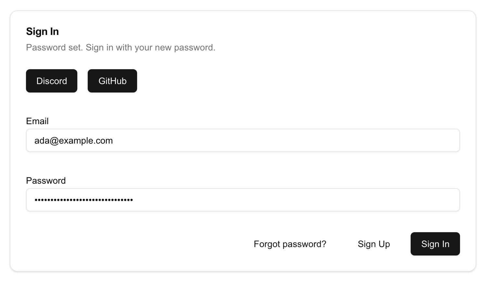
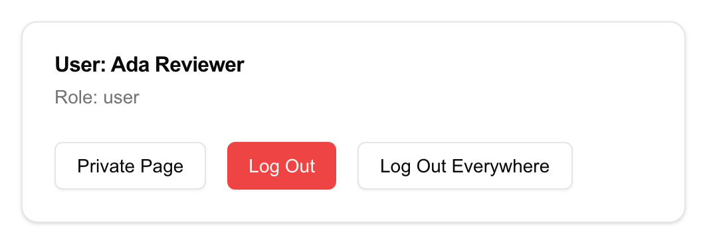
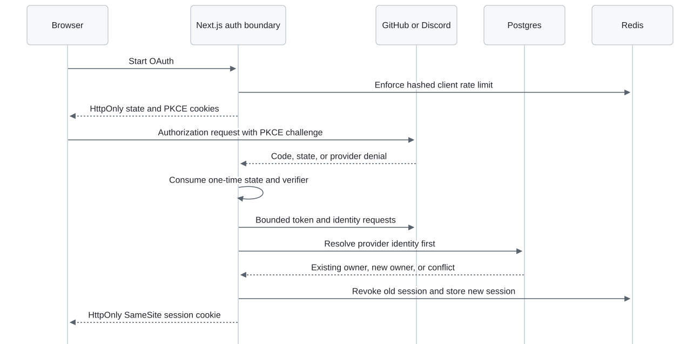

# Next.js OAuth 2.0 Security Reference

[](https://github.com/hskl18/nextjs-oauth-security-reference/actions/workflows/ci.yml)

GitHub and Discord sign-in plus email-link passwords for Next.js, built so that a matching email never counts as proof of account ownership and only the mailbox holder ever chooses a password.

**Status: reference implementation, v0.2.0.** It is not a drop-in identity provider and has no production deployment.
Production builds disable password sign-up and reset until an email provider is wired in.





*A local production build of `main` on 2026-11-08, with PostgreSQL and Redis from Docker Compose; the account was created through the development email-link flow.*

## Headline result

CI runs 77 tests in 22 files on every push and pull request.
19 of them, in 5 integration files, run only against real PostgreSQL 17 and Redis 7, so database constraints, row locks, and Redis scripts are exercised rather than mocked.

| Attack or race | What the test shows | Test file |
| --- | --- | --- |
| Two concurrent OAuth callbacks for one new provider account | Both resolve to one user and one provider link | `postgresAccountStore.integration.test.ts` |
| OAuth email that matches an existing local account | Sign-in is refused and no provider identity is attached | `postgresAccountStore.integration.test.ts` |
| Two concurrent uses of one password setup link | Exactly one succeeds | `passwordSetup.integration.test.ts` |
| Three concurrent link requests for one user | Exactly one link stays live | `passwordSetup.integration.test.ts` |
| Admin role removed while signed in on two devices | The other device is a plain user on its next request | `sessionRevocation.integration.test.ts` |
| Login that read the session version before a concurrent sign-out-everywhere | Its session is rejected | `sessionRevocation.integration.test.ts` |
| Sixth sign-up attempt within an hour | Rejected, and Redis keys never contain the raw email | `rateLimit.integration.test.ts` |
| Redis that never answers or refuses connections | The rate limit rejects the attempt | `rateLimit.test.ts` |

[DESIGN.md](DESIGN.md) explains the decisions behind these rules and nine failures that were found and fixed, including a rate limiter that failed open and a deadlock reproduced in PostgreSQL.

## Architecture

<picture>
  <source media="(prefers-color-scheme: dark)" srcset="docs/architecture-dark.svg">
  
</picture>

## What this implements

- OAuth identity is resolved by `(provider, providerAccountId)` first; an email that matches an existing local account never signs in to or links that account.
- GitHub requires a verified primary email from `/user/emails`, and Discord requires its `verified` field.
- OAuth `state` and the PKCE verifier are one-time cookies, cleared after success, denial, malformed callbacks, rate limits, and validation failures.
- Sessions are opaque Redis identifiers with an absolute seven-day lifetime, rotated on every login.
- Role and revocation state come from PostgreSQL on every authorized request, so a role change, sign-out-everywhere, or password reset applies to every device on its next request.
- Password sign-up and reset set the password only through a one-hour, single-use emailed link.
- Per-flow Redis rate limits with hashed keys cover password sign-in, sign-up, password setup emails, OAuth start, and OAuth callback, and fail closed when Redis is slow or unreachable.

## Run it

Requires Docker and Node.js 22.13 or newer within the 22.x line, Node.js 24, or Node.js 26 and newer.

```bash
cp .env.example .env.local && docker compose --env-file .env.local up -d && npm ci && npm run db:migrate && npm run dev
```

Open `http://localhost:3000`.
Docker Compose runs PostgreSQL, Redis, and [serverless-redis-http](https://github.com/hiett/serverless-redis-http), an Upstash-compatible REST proxy, so the app uses the same `@upstash/redis` client locally as against Upstash.
In development, password setup links are printed to the server console instead of being emailed.
GitHub and Discord sign-in need your own OAuth apps: replace the `replace-me` values in `.env.local` and register these callback URLs.

```text
http://localhost:3000/api/oauth/github
http://localhost:3000/api/oauth/discord
```

The [development guide](docs/development.md) shows how to run the integration tests against a separate database, the checks to run before a pull request, and where each part of the code lives.

## Non-goals

- Replacing Auth.js, Better Auth, an enterprise identity provider, or a managed OAuth broker
- Supporting arbitrary OAuth providers through runtime configuration
- Merging social accounts based only on email
- Claiming compliance, production readiness, or complete resistance to account takeover

## Limits

- There is no production deployment, monitoring, audit log, or formal security assessment.
- Email delivery has only a development console transport, so production builds disable sign-up and reset until a provider is wired into `src/auth/core/email.ts`.
- Sessions and rate limits need Redis; sign-in, sign-up, and OAuth fail closed while Redis is slow or unreachable.

The [threat model](docs/threat-model.md) maps each threat to its control and tests and lists every known limit.

## Reporting a vulnerability

Please follow [SECURITY.md](SECURITY.md) and do not post credentials, tokens, personal data, or exploit details in a public issue.

## License

This project is available under the [MIT License](LICENSE).
