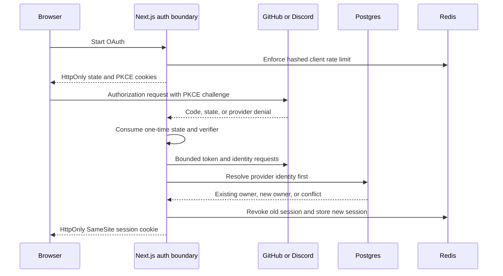

# Next.js OAuth 2.0 Security Reference

This repository demonstrates password and OAuth sign-in without treating a matching provider email as proof that two accounts have the same owner.

It is a security-focused reference implementation, not a drop-in production identity provider.
The useful artifact is the account-ownership policy, its database constraints, and the regression tests around failure and concurrency.

## What this proves

- GitHub identity uses `(provider, providerAccountId)` and a verified primary email from `/user/emails`.
- Discord identity requires the provider `verified` field.
- An OAuth email matching an existing local account does not authenticate or silently link that account.
- State and PKCE verifier cookies are one-time values and are cleared after success, denial, malformed callbacks, rate limits, and validation failures.
- A successful password or OAuth login revokes the previous session before issuing a new opaque session identifier with an absolute seven-day lifetime.
- Sessions name a user and a session version only; role and revocation state are read from PostgreSQL on every authorized request, so a role change or sign-out-everywhere applies to every device on its next request.
- Protected pages and actions check authorization themselves; there is no request proxy to bypass or to rewrite sessions concurrently.
- PostgreSQL uniqueness constraints make provider ownership and one-account-per-provider rules enforceable under concurrent callbacks.
- Redis-backed limits cover password sign-in, sign-up, OAuth start, and OAuth callback attempts.

## 60-second local path

Use Node.js 22.13 or newer within the 22.x release line, Node.js 24, or Node.js 26 and newer, with npm.
CI uses Node.js 22.

```bash
npm ci
cp .env.example .env.local
# Fill in the GitHub and Discord OAuth app credentials in .env.local.
docker compose --env-file .env.local up -d
npm run db:migrate
npm run dev
```

Open `http://localhost:3000`.

Docker Compose runs PostgreSQL, Redis, and [serverless-redis-http](https://github.com/hiett/serverless-redis-http), an Upstash-compatible REST proxy, so the app uses the same `@upstash/redis` client locally as against Upstash.
The defaults in `.env.example` match the Compose services; `drizzle.config.ts` loads `.env.local` through `@next/env`.
Provider callbacks require separate GitHub and Discord OAuth applications.

Configure callback URLs as:

```text
http://localhost:3000/api/oauth/github
http://localhost:3000/api/oauth/discord
```

Set `OAUTH_REDIRECT_URL_BASE=http://localhost:3000/api/oauth/`.

## Account-linking policy

The callback always resolves `(provider, providerAccountId)` first.

1. If the provider account is already linked, only its attached local user can sign in.
2. If the provider account is new and its verified email is unused, the callback creates one user and one provider link in a transaction.
3. If the verified email already belongs to a local user, the callback fails with a generic public error.
4. A concurrent insert conflict is re-read from PostgreSQL, and only the database owner of the provider identity is returned.

Explicit account linking is intentionally not implemented yet.
A future linking flow must start from an authenticated local session, require fresh provider authorization, and show a confirmation before committing the link.

## Architecture



## Threat model

| Threat | Primary control | Evidence |
| --- | --- | --- |
| Login CSRF and callback replay | Random state, PKCE S256, one-time cookie consumption | State mismatch, missing verifier, denial, and replay tests |
| Email-based account takeover | Provider identity first and no email auto-link | Core ownership tests and PostgreSQL integration test |
| Unverified provider email | GitHub verified primary selection and Discord `verified: true` | Provider-specific tests |
| Concurrent callback ownership ambiguity | Transactional inserts and unique provider constraints | Concurrent PostgreSQL integration test |
| Session fixation or unbounded extension | Existing Redis session is revoked before login rotation, and sessions are never rewritten after login | Session rotation and expiration tests |
| Stale privileges or lost revocation across devices | Role and session version come from PostgreSQL per request; sign-out-everywhere increments the version | Current-user, admin page, and sign-out-everywhere tests |
| Provider failure or malicious payload | Five-second timeout, no redirects, status checks, JSON and Zod validation | Provider response tests |
| Brute force and callback abuse | Redis sliding-window limits with hashed identifiers that fail closed when Redis times out or is unreachable | Rate-limit unit tests and Redis integration tests |
| Open redirect through callback parameters | Fixed same-origin destinations only | Callback redirect regression test |

This model assumes PostgreSQL and Redis are trusted application dependencies and that TLS is terminated by the deployment platform.
The implementation trusts Vercel's forwarded client address only when `VERCEL=1`.
Other deployments intentionally share the `unknown-client` bucket until a reviewed trusted-proxy adapter is added.

## Verification

Type checking uses TypeScript 7 through the `@typescript/native` npm alias.
The `typescript` alias supplies Microsoft's TypeScript 6 compatibility API for Next.js and typescript-eslint, following the [official side-by-side setup](https://devblogs.microsoft.com/typescript/announcing-typescript-7-0/#running-side-by-side-with-typescript-6.0).
ESLint stays on 9.39.5 because the React, accessibility, and import plugins used by `eslint-config-next` do not yet declare ESLint 10 support.
`@upstash/ratelimit` stays on 2.0.8 because 2.1.0 and later prefix every Lua script with an Upstash-only `allow-key-locking` flag that stock Redis rejects ([upstash/ratelimit-js#162](https://github.com/upstash/ratelimit-js/issues/162)).
`npm run typecheck` generates Next.js route types before checking a fresh checkout.

```bash
npm audit --audit-level=low
npm run lint
npm run typecheck
npm test
npm run build
```

The default local test run skips integration tests.
`RUN_DB_INTEGRATION=1` enables the PostgreSQL tests, and `RUN_REDIS_INTEGRATION=1` enables the Redis tests; the session-revocation tests need both.
GitHub Actions starts PostgreSQL 17, Redis 7, and serverless-redis-http, applies the generated migrations, sets both flags, and runs the same suite against real database constraints and real Redis scripts.
The integration tests delete every user and OAuth account, so run them locally against a disposable database, not the one `npm run dev` uses:

```bash
docker compose --env-file .env.local exec db createdb -U postgres oauth_template_test
set -a; source .env.local; set +a
export DB_NAME=oauth_template_test RUN_DB_INTEGRATION=1 RUN_REDIS_INTEGRATION=1
npm run db:migrate
npm test
```

The test matrix covers:

- state mismatch and one-time cookie deletion
- missing or reused PKCE verifier
- callback replay and provider denial
- null GitHub public email and verified primary selection
- unverified GitHub and Discord email
- provider account already linked to another local user
- existing local user with a matching email
- concurrent provider callbacks
- session rotation and absolute expiration
- database role and session version override stale sessions
- server-side admin page authorization
- sign-out-everywhere revocation
- callback open-redirect attempts
- hashed Redis rate-limit identifiers and per-scope budgets against real Redis
- rate limits failing closed on Redis timeout and connection refusal
- Redis session TTL, rotation, logout deletion, and rejection of pre-version sessions
- role downgrade and sign-out-everywhere across two devices against PostgreSQL and Redis
- a login that read the session version before a concurrent sign-out-everywhere
- role downgrade authorization from the earlier hardening pass

## Security boundaries and limitations

- Password sign-up does not yet verify ownership of the submitted email.
- There is no password-reset flow, MFA, recovery-code flow, account deletion flow, or explicit OAuth account-linking UI.
- Redis availability is required for sessions and authentication rate limits; sign-in, sign-up, and OAuth fail closed while Redis is slow or unreachable.
- Rate limiting is application-level defense in depth and does not replace edge abuse controls.
- Security headers are configured, but a nonce-based Content Security Policy is not yet included.
- Provider tokens are used only for the callback exchange and are not persisted.
- The example has no production deployment, operational monitoring, audit log, incident response automation, or formal security assessment.
- Docker Compose is a local development dependency and is not a production deployment design.

## Non-goals

- Replacing Auth.js, Better Auth, an enterprise identity provider, or a managed OAuth broker
- Supporting arbitrary OAuth providers through runtime configuration
- Demonstrating social-account merging based only on email
- Claiming compliance, production readiness, or complete resistance to account takeover

## Repository map

| Path | Responsibility |
| --- | --- |
| `src/auth/core/oauth/base.ts` | One-time OAuth attempt handling and bounded provider requests |
| `src/auth/core/oauth/account.ts` | Provider-first account ownership policy |
| `src/auth/core/oauth/postgresAccountStore.ts` | Transactional PostgreSQL adapter |
| `src/auth/core/session.ts` | Opaque Redis sessions and login rotation |
| `src/auth/nextjs/currentUser.ts` | Per-request authorization from the database row |
| `src/auth/core/rateLimit.ts` | Hashed Redis rate-limit keys and policy |
| `src/app/api/oauth/[provider]/route.ts` | OAuth callback boundary |
| `src/drizzle/schema.ts` | User and provider-account constraints |

## Reporting a vulnerability

Please follow [SECURITY.md](SECURITY.md) and do not post credentials, tokens, personal data, or exploit details in a public issue.

## License

This project is available under the [MIT License](LICENSE).
